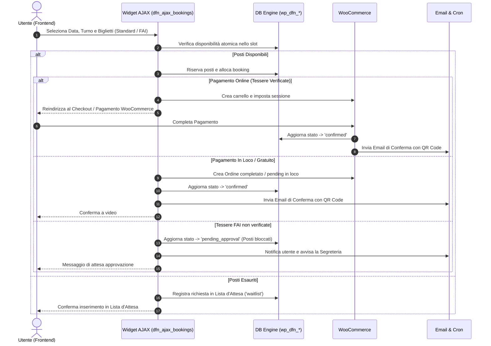

# 🎟️ Motore di Prenotazione & Flussi Operativi

Il motore di prenotazione DFN gestisce in modo unificato la disponibilità dei posti, il ticketing WooCommerce, la validazione delle tessere soci e le notifiche.

---

## 1. Ciclo di Vita della Prenotazione

---

## 2. Gestione Soci FAI
- L'utente può inserire 1 o più biglietti a prezzo ridotto per Soci FAI.
- Per ciascun biglietto FAI viene richiesto il numero di tessera e l'anagrafica intestatario.
- **Controllo duplicati**: La stessa tessera FAI non può essere inserita due volte nella stessa prenotazione, né essere riutilizzata per lo stesso evento.
- **Verifica automatica**: Se il numero tessera esiste nella tabella `wp_dfn_fai_members` ed è valido, lo sconto viene applicato istantaneamente.
- **Flusso manuale (*Pending Approval*)**: Se la tessera non è presente o non coincide il nominativo, l'ordine non fallisce: viene inviato in approvazione manuale alla segreteria, trattenendo i posti per evitare overbooking.

---

## 3. Gestione Lista d'Attesa (*Waitlist*)
- Se un turno raggiunge la capienza massima (incluso l'eventuale margine di overbooking consentito), il widget permette di iscriversi alla Lista d'Attesa.
- In caso di cancellazione di una prenotazione confermata, il sistema notifica automaticamente i candidati in lista d'attesa in ordine cronologico di registrazione.

---

## 4. Rettifica Posti & Sincronizzazione Magazzino (Admin)

Nelle situazioni operative reali (es. comunicazioni o errori del visitatore che ha selezionato posti in eccesso o errata ripartizione tra interi e soci), la Segreteria può rettificare la prenotazione direttamente dal pannello prima della conferma/saldo, evitando la cancellazione e reinserimento manuale:

### Stati Abilitati alla Rettifica
- **`pending_approval`**: Prenotazione in attesa di validazione tessere FAI.
- **`pending_payment`**: Prenotazione registrata in attesa di saldo/conferma.
- *(Le prenotazioni già completate, pagate o cancellate sono protette contro modifiche accidentali per garantire la conformità contabile).*

### Azioni Atomiche Eseguite dal Sistema (`dfn_admin_update_booking_seats`)
1. **Aggiornamento Tabelle Prenotazioni**:
   - Ricalcola `total_persons`, `persons_standard`, `persons_fai` e `amount_due` in `wp_dfn_bookings`.
   - Aggiorna i posti occupati in `wp_dfn_booking_slots` e ricalcola il contatore `booked_count` in `wp_dfn_event_slots`.
2. **Sincronizzazione Scorte Magazzino WooCommerce**:
   - Calcola la variazione algebrica netta ($\Delta\text{ posti} = \text{nuovo totale} - \text{vecchio totale}$).
   - Se i posti diminuiscono (es. da 3 a 2), restituisce $+1$ unità al magazzino del prodotto evento associato (`wc_update_product_stock()`).
   - Se i posti aumentano, riserva le unità addizionali previa verifica della capienza residua.
3. **Aggiornamento Ordine WooCommerce Associato**:
   - Aggiorna la quantità dell'item prodotto (`set_quantity()`), il subtotale e il totale dell'ordine.
   - Sincronizza i metadati custom dell'item: `_dfn_qty_standard`, `_dfn_qty_fai`, `_dfn_fai_cards` e `_reduced_stock`.
   - Ricalcola la voce "Sconto Soci FAI" (`WC_Order_Item_Fee`) in base alla nuova ripartizione.
   - Registra una nota d'ordine di sistema tracciando la rettifica effettuata dall'operatore.
