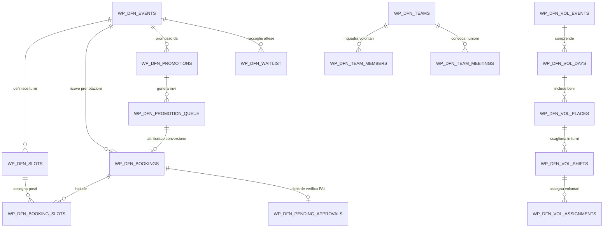

# 🗄️ Schema Database & Tabelle Personalizzate

> **Riferimento Architetturale Database (v2.0 / v2.1 / v2.1.1)**  
> Il sistema estende il database di WordPress con tabelle relazionali ottimizzate, create e manutenute in modo idempotente tramite `dbDelta` in [dfn-database.php](file:///c:/Users/Alex/Desktop/web-server/dfn-bedrock/web/app/themes/dfn-theme/inc/core/dfn-database.php) e versionate mediante la costante `DFN_DB_VERSION`.

---

## 1. Mappa Relazionale ad Alto Livello (ER Diagram)

---

## 2. Dettaglio Tabelle: Modulo 2.0 (Core Prenotazioni & Marketing)

### `wp_dfn_events`
Memorizza le proprietà strutturali, il tipo di accesso e le tariffe di ciascun evento.

| Colonna | Tipo | Descrizione |
|---|---|---|
| `id` | `BIGINT(20) UNSIGNED` | Chiave primaria auto-increment |
| `product_id` | `BIGINT(20) UNSIGNED` | ID del prodotto WooCommerce associato |
| `title` | `VARCHAR(255)` | Titolo dell'evento culturale |
| `access_type` | `VARCHAR(20)` | `slots` (a fasce orarie) o `free_flow` (accesso continuo) |
| `payment_mode` | `VARCHAR(20)` | `online` (Stripe/PayPal), `in_loco` (cassa al banco), `gratuito` |
| `price_standard` | `DECIMAL(10,2)` | Quota ordinaria biglietto intero |
| `price_fai` | `DECIMAL(10,2)` | Quota agevolata riservata ai Soci FAI |
| `is_active` | `TINYINT(1)` | Flag disponibilità (1 = visibile online, 0 = bozza/concluso) |
| `created_at` | `DATETIME` | Data e ora di inserimento |

---

### `wp_dfn_slots`
Definisce le singole fasce orarie e monitora la capienza in tempo reale.

| Colonna | Tipo | Descrizione |
|---|---|---|
| `id` | `BIGINT(20) UNSIGNED` | Chiave primaria auto-increment |
| `event_id` | `BIGINT(20) UNSIGNED` | FK verso `wp_dfn_events.id` |
| `slot_date` | `DATE` | Data del turno (YYYY-MM-DD) |
| `start_time` | `TIME` | Orario inizio turno (HH:MM:SS) |
| `end_time` | `TIME` | Orario fine turno (HH:MM:SS) |
| `max_capacity` | `INT(11)` | Capienza massima ordinaria |
| `overbooking_max` | `INT(11)` | Tolleranza posti extra ammessi per urgenze |
| `booked_count` | `INT(11)` | Posti confermati attualmente occupati |
| `status` | `VARCHAR(20)` | `active`, `closed`, `cancelled` |

---

### `wp_dfn_bookings`
Memorizza la prenotazione complessiva collegata alla transazione WooCommerce.

| Colonna | Tipo | Descrizione |
|---|---|---|
| `id` | `BIGINT(20) UNSIGNED` | Chiave primaria auto-increment |
| `order_id` | `BIGINT(20) UNSIGNED` | ID dell'ordine WooCommerce collegato |
| `event_id` | `BIGINT(20) UNSIGNED` | FK verso `wp_dfn_events.id` |
| `user_id` | `BIGINT(20) UNSIGNED` | ID utente WP (opzionale se acquisto ospite) |
| `status` | `VARCHAR(30)` | `confirmed`, `pending_payment`, `pending_approval`, `cancelled` |
| `qr_code_hash` | `VARCHAR(64)` | Token univoco SHA-256 per validazione QR code |
| `checkin_status` | `VARCHAR(20)` | `pending`, `checked_in`, `partial` |
| `checkin_at` | `DATETIME` | Data e ora della prima convalida all'ingresso |

---

### `wp_dfn_booking_slots`
Tabella ponte N:M tra prenotazioni e fasce orarie per gestione multi-slot o gruppi scaglionati.

| Colonna | Tipo | Descrizione |
|---|---|---|
| `id` | `BIGINT(20) UNSIGNED` | Chiave primaria |
| `booking_id` | `BIGINT(20) UNSIGNED` | FK verso `wp_dfn_bookings.id` |
| `slot_id` | `BIGINT(20) UNSIGNED` | FK verso `wp_dfn_slots.id` |
| `quantity` | `INT(11)` | Numero di persone assegnate a questo specifico turno |

---

### `wp_dfn_fai_members`
Registro anagrafico locale per la validazione automatica istantanea delle tessere FAI.

| Colonna | Tipo | Descrizione |
|---|---|---|
| `id` | `BIGINT(20) UNSIGNED` | Chiave primaria |
| `card_number` | `VARCHAR(50)` | Numero tessera FAI (indicizzato) |
| `first_name` | `VARCHAR(100)` | Nome del socio |
| `last_name` | `VARCHAR(100)` | Cognome del socio |
| `status` | `VARCHAR(20)` | `active`, `expired`, `suspended` |
| `expiry_date` | `DATE` | Data di scadenza validità della tessera |
| `created_at` | `DATETIME` | Timestamp di acquisizione |

---

### `wp_dfn_pending_approvals`
Code di controllo manuale per tessere FAI non riconosciute automaticamente.

| Colonna | Tipo | Descrizione |
|---|---|---|
| `id` | `BIGINT(20) UNSIGNED` | Chiave primaria |
| `booking_id` | `BIGINT(20) UNSIGNED` | FK verso `wp_dfn_bookings.id` |
| `card_number` | `VARCHAR(50)` | Numero di tessera dichiarato dal cliente |
| `holder_name` | `VARCHAR(150)` | Nominativo riportato sulla tessera |
| `status` | `VARCHAR(20)` | `pending`, `approved`, `rejected` |
| `verified_by` | `BIGINT(20) UNSIGNED` | ID utente della segreteria che ha approvato |
| `verified_at` | `DATETIME` | Data e ora dell'approvazione |

---

### `wp_dfn_waitlist`
Gestione automatica delle liste d'attesa per eventi o turni sold-out.

| Colonna | Tipo | Descrizione |
|---|---|---|
| `id` | `BIGINT(20) UNSIGNED` | Chiave primaria |
| `event_id` | `BIGINT(20) UNSIGNED` | FK verso `wp_dfn_events.id` |
| `slot_id` | `BIGINT(20) UNSIGNED` | FK opzionale verso `wp_dfn_slots.id` |
| `user_email` | `VARCHAR(255)` | Email del visitatore in lista d'attesa |
| `user_name` | `VARCHAR(150)` | Nominativo del visitatore |
| `user_phone` | `VARCHAR(50)` | Recapito telefonico |
| `seats_requested` | `INT(11)` | Posti richiesti |
| `status` | `VARCHAR(20)` | `waiting`, `notified`, `converted`, `expired` |
| `created_at` | `DATETIME` | Data e ora iscrizione in lista d'attesa |

---

### `wp_dfn_promotions`
Campagne promozionali e newsletter di lancio eventi.

| Colonna | Tipo | Descrizione |
|---|---|---|
| `id` | `BIGINT(20) UNSIGNED` | Chiave primaria auto-increment |
| `event_id` | `BIGINT(20) UNSIGNED` | FK verso `wp_dfn_events.id` |
| `title` | `VARCHAR(255)` | Titolo interno descrittivo della campagna |
| `email_subject` | `VARCHAR(255)` | Oggetto dell'email visualizzato dal destinatario |
| `email_intro` | `TEXT` | Testo introduttivo dell'email |
| `email_custom_text` | `TEXT` | Corpo esteso del messaggio promozionale |
| `cta_text` | `VARCHAR(100)` | Testo del pulsante di prenotazione |
| `status` | `VARCHAR(20)` | `draft`, `scheduled`, `sending`, `completed`, `cancelled` |
| `total_recipients` | `INT(10) UNSIGNED` | Numero totale destinatari in lista |
| `sent_count` | `INT(10) UNSIGNED` | Conteggio email inviate con successo |
| `failed_count` | `INT(10) UNSIGNED` | Conteggio email fallite / rimbalzate |
| `opened_count` | `INT(10) UNSIGNED` | Destinatari univoci che hanno aperto l'email |
| `clicked_count` | `INT(10) UNSIGNED` | Destinatari univoci che hanno cliccato sulla CTA |
| `converted_count` | `INT(10) UNSIGNED` | Ordini WooCommerce convertiti tramite la campagna |
| `revenue_generated` | `DECIMAL(10,2)` | Totale economico (€) generato dalla campagna |
| `batch_size` | `INT(10) UNSIGNED` | Dimensione lotti successivi (default: 25) |
| `initial_batch_size` | `INT(10) UNSIGNED` | Dimensione lotto iniziale di prova (default: 15) |
| `batch_interval_minutes` | `INT(10) UNSIGNED` | Minuti di attesa tra un lotto e il successivo |
| `last_batch_at` | `DATETIME` | Timestamp dell'ultimo lotto elaborato dal cron |
| `scheduled_at` | `DATETIME` | Data e ora pianificata per l'avvio invio |
| `completed_at` | `DATETIME` | Data e ora di conclusione della campagna |
| `created_by` | `BIGINT(20) UNSIGNED` | ID utente dell'amministratore/autore |
| `created_at` | `DATETIME` | Timestamp creazione record |
| `updated_at` | `DATETIME` | Timestamp ultimo aggiornamento |

---

### `wp_dfn_promotion_queue`
Coda di spedizione, token crittografici e metriche di interazione individuale.

| Colonna | Tipo | Descrizione |
|---|---|---|
| `id` | `BIGINT(20) UNSIGNED` | Chiave primaria auto-increment |
| `promotion_id` | `BIGINT(20) UNSIGNED` | FK verso `wp_dfn_promotions.id` |
| `recipient_email` | `VARCHAR(255)` | Indirizzo email del destinatario |
| `recipient_name` | `VARCHAR(255)` | Nome e cognome del destinatario |
| `status` | `VARCHAR(20)` | `pending`, `sent`, `failed`, `cancelled` |
| `tracking_token` | `VARCHAR(64)` | Token univoco (32 byte) per pixel apertura e CTA |
| `error_message` | `TEXT` | Motivo dell'eventuale fallimento di consegna |
| `opened_at` | `DATETIME` | Timestamp prima apertura accertata |
| `open_count` | `INT(10) UNSIGNED` | Conteggio aperture complessive registrate |
| `clicked_at` | `DATETIME` | Timestamp primo click sul link della CTA |
| `click_count` | `INT(10) UNSIGNED` | Conteggio click complessivi registrati |
| `converted_at` | `DATETIME` | Data e ora finalizzazione acquisto |
| `booking_id` | `BIGINT(20) UNSIGNED` | ID prenotazione DFN generata |
| `order_id` | `BIGINT(20) UNSIGNED` | ID ordine WooCommerce generato |
| `order_total` | `DECIMAL(10,2)` | Importo speso dall'acquirente |
| `sent_at` | `DATETIME` | Timestamp effettivo di spedizione email |
| `created_at` | `DATETIME` | Data inserimento riga in coda |

---

## 3. Dettaglio Tabelle: Modulo 2.1 (Gestione Volontari & Matrice Turni)

### `wp_dfn_vol_events` & `wp_dfn_vol_days`
Inquadramento manifestazioni volontari (es. *Giornate FAI di Autunno*, *Giornate FAI di Primavera*) suddivise in giornate operative.

| Tabella | Colonne Chiave | Scopo |
|---|---|---|
| `wp_dfn_vol_events` | `id`, `title`, `year`, `season`, `is_active` | Macro-evento di Delegazione |
| `wp_dfn_vol_days` | `id`, `event_id`, `event_date`, `notes` | Singole date operative (Sabato, Domenica) |

---

### `wp_dfn_vol_places` & `wp_dfn_vol_shifts`
Luoghi aperti al pubblico (Beni FAI, Chiese, Palazzi) e turnazione oraria di presidio dei volontari.

| Tabella | Colonne Chiave | Scopo |
|---|---|---|
| `wp_dfn_vol_places` | `id`, `day_id`, `place_name`, `address`, `city` | Luogo/Bene affidato alla Delegazione |
| `wp_dfn_vol_shifts` | `id`, `place_id`, `start_time`, `end_time`, `min_volunteers` | Fascia oraria di servizio richiesta |

---

### `wp_dfn_vol_assignments`
Matrice di assegnazione volontari ai turni con rilevamento conflitti orari e ruoli operativi.

| Colonna | Tipo | Descrizione |
|---|---|---|
| `id` | `BIGINT(20) UNSIGNED` | Chiave primaria |
| `shift_id` | `BIGINT(20) UNSIGNED` | FK verso `wp_dfn_vol_shifts.id` |
| `user_id` | `BIGINT(20) UNSIGNED` | ID utente WordPress del volontario |
| `role_id` | `BIGINT(20) UNSIGNED` | FK verso `wp_dfn_roles.id` (Accoglienza, Cassa, Guida...) |
| `status` | `VARCHAR(20)` | `assigned`, `confirmed`, `declined` |
| `notes` | `TEXT` | Note logistiche e preferenze personali |

---

### `wp_dfn_vol_surveys` & `wp_dfn_vol_survey_responses`
Sondaggi preventivi di disponibilità oraria e logistica compilati dai volontari dall'area riservata `/mio-account/`.

| Tabella | Colonne Chiave | Scopo |
|---|---|---|
| `wp_dfn_vol_surveys` | `id`, `event_id`, `title`, `deadline_date`, `is_open` | Campagna di raccolta disponibilità |
| `wp_dfn_vol_survey_responses` | `id`, `survey_id`, `user_id`, `day_id`, `shift_preference` | Risposta singola del volontario |

---

### `wp_dfn_meetings`
Convocazioni e presenze per le riunioni plenarie di Delegazione.

| Colonna | Tipo | Descrizione |
|---|---|---|
| `id` | `BIGINT(20) UNSIGNED` | Chiave primaria |
| `title` | `VARCHAR(255)` | Titolo riunione (es. *Plenaria Giornate FAI*) |
| `meeting_date` | `DATETIME` | Data e ora di svolgimento |
| `location` | `VARCHAR(255)` | Luogo fisico o link telematico (Google Meet/Teams) |
| `agenda` | `TEXT` | Ordine del giorno |
| `created_at` | `DATETIME` | Timestamp creazione |

---

## 4. Dettaglio Tabelle: Modulo 2.1.1 (Squadre di Lavoro & Team)

### `wp_dfn_teams`
Definizione dei gruppi operativi specializzati di Delegazione (*Ambiente, Scuola, Guide, Comunicazione, Eventi*).

| Colonna | Tipo | Descrizione |
|---|---|---|
| `id` | `BIGINT(20) UNSIGNED` | Chiave primaria |
| `name` | `VARCHAR(150)` | Nome del Team operativo |
| `description` | `TEXT` | Finalità e ambiti di competenza del gruppo |
| `leader_user_id` | `BIGINT(20) UNSIGNED` | ID utente del Delegato Responsabile di Team |
| `whatsapp_group_link` | `VARCHAR(255)` | Link Click-to-Chat al gruppo WhatsApp riservato |
| `drive_folder_url` | `VARCHAR(255)` | Cartella condivisa Google Drive documentale |
| `is_active` | `TINYINT(1)` | Flag abilitazione (1 = attivo, 0 = archiviato) |

---

### `wp_dfn_team_members`
Associazione dei volontari ai rispettivi Team di competenza.

| Colonna | Tipo | Descrizione |
|---|---|---|
| `id` | `BIGINT(20) UNSIGNED` | Chiave primaria |
| `team_id` | `BIGINT(20) UNSIGNED` | FK verso `wp_dfn_teams.id` |
| `user_id` | `BIGINT(20) UNSIGNED` | ID utente WP del volontario componente del team |
| `role_in_team` | `VARCHAR(50)` | `member`, `leader`, `supervisor` |
| `joined_at` | `DATETIME` | Data di inserimento nella squadra |
