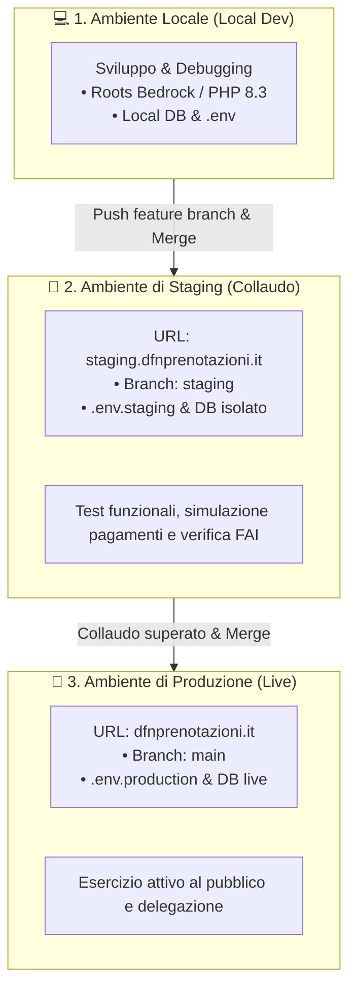

# 🚀 Ambienti di Sviluppo, Git Workflow & CI/CD Deployment

Il progetto **DFN Bedrock** adotta un'architettura a **tre ambienti distinti** e un modello di branching strutturato per garantire massima stabilità, isolamento delle funzionalità e rilasci controllati.

---

## 1. Mappa dei Tre Ambienti



### Dettaglio Ambienti:

| Caratteristica | 💻 Locale (Local Development) | 🧪 Staging (Collaudo & Test) | 🚀 Produzione (Live / Esercizio) |
|---|---|---|---|
| **Scopo** | Sviluppo attivo, debug, linting e test unitari | Test di integrazione, verifica staff, simulazione flussi | Ambiente live per il pubblico e delegazione |
| **URL Web** | `http://dfn-bedrock.local` (o server locale) | `https://staging.dfnprenotazioni.it` | `https://dfnprenotazioni.it` |
| **Branch Git** | Feature branch (es. `dfn-2.1-gestione-volontari`) | `staging` | `main` |
| **Database** | Database locale isolato | Database di test staging dedicato | Database di produzione MySQL live |
| **Configurazione** | `.env` locale | `.env.staging` | `.env.production` |
| **Gateway Pagamenti** | Sandbox / Test mode | Sandbox / Test mode | Modalità Live reale |
| **Notifiche Email** | Mailtrap / Log locale | Destinatari di test / Staff | Utenti e visitatori reali |

---

## 2. Struttura dei Rami Git

```mermaid
gitGraph
    commit id: "v1.0 - Core Engine"
    branch dfn-2.0.1-gestione-prenotazioni
    checkout dfn-2.0.1-gestione-prenotazioni
    commit id: "feat: Booking Engine v2.0.1"
    commit id: "feat: PWA Scanner & Botteghino"
    branch dfn-2.1-gestione-volontari
    checkout dfn-2.1-gestione-volontari
    commit id: "feat: Volunteer System & Roles"
    branch dfn-2.1.1-gestione-team
    checkout dfn-2.1.1-gestione-team
    commit id: "feat: Specialised Teams & Channels"
    checkout main
    merge dfn-2.1-gestione-volontari id: "Merge to Main (v2.1)"
    checkout staging
    merge main id: "Deploy Staging"
```

### Ruolo dei Rami:
- **`main`**: Ramo protetto di produzione. Qualsiasi merge su `main` riflette il codice live in produzione.
- **`staging`**: Ramo di pre-rilascio allineato all'ambiente di collaudo (`staging.dfnprenotazioni.it`).
- **`dfn-2.0.1-gestione-prenotazioni`**: Ramo attivo e consolidato per il motore di prenotazione, widget, checkout WooCommerce, scorte di magazzino e scanner PWA (sostituisce integralmente il ramo storico `dfn-2.0-gestione-prenotazioni`).
- **`dfn-2.1-gestione-volontari`**: Ramo dedicato alle funzionalità del modulo volontari, turni, ruoli e anagrafica SiVol.
- **`dfn-2.1.1-gestione-team`**: Ramo opzionale per la gestione dei team di lavoro specializzati, delegati di gruppo e canali dedicati.

---

## 3. Pipeline CI/CD & Modalità di Deployment

Il rilascio dei file su Staging e Produzione è completamente automatizzato tramite **GitHub Actions**:

1. **Deploy automatico su Staging:**
   - **Trigger:** Ogni push o merge sul ramo `staging`.
   - **Workflow:** `.github/workflows/deploy-staging.yml`.
   - **Azione:** Sincronizza i file del tema (`web/app/themes/dfn-theme/`) sul server di staging.

2. **Deploy automatico su Produzione:**
   - **Trigger:** Ogni push o merge sul ramo `main`.
   - **Workflow:** `.github/workflows/deploy.yml`.
   - **Azione:** Sincronizza in modo sicuro i file del tema su `dfnprenotazioni.it`.

3. **Deploy Manuale / Patch Rapida:**
   - In caso di necessità operative, è disponibile la sincronizzazione diretta HTTP/FTP tramite endpoint cifrato `deploy_file.php` per aggiornare singoli file critici in tempo reale.

---

## 4. Best Practice per lo Sviluppo

1. **Mai sviluppare direttamente su `main` o in produzione:** Tutte le modifiche vengono scritte in locale su un feature branch dedicato.
2. **Issue su GitHub obbligatoria:** Per ogni bugfix o nuova feature viene associata una issue di riferimento per tracciare decisioni, commit e motivazioni.
3. **Flusso di rilascio standard:**
   $$\text{Sviluppo Locale} \longrightarrow \text{Push Branch} \longrightarrow \text{Merge su staging} \longrightarrow \text{Test} \longrightarrow \text{Merge su main} \longrightarrow \text{Deploy Produzione}$$
